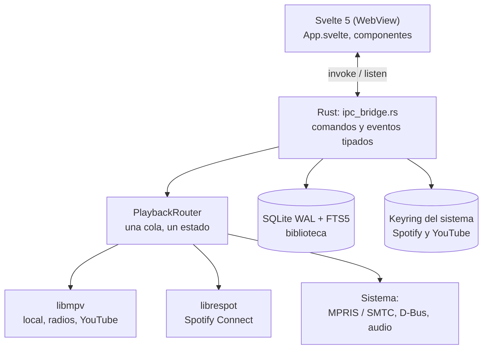

<div align="center">

<picture>
  <source media="(prefers-color-scheme: dark)" srcset="docs/assets/portada-oscura.png" />
  
</picture>

# Música

**Reproductor de música de escritorio, ligero y sin anuncios.**

Biblioteca local, YouTube Music, Spotify Connect, radios, podcasts y servidores
propios en una sola cola. El repositorio se llama **catPet**.


[Descargar](#descargar) |
[Características](#características) |
[Capturas](#capturas) |
[Instalación](#instalación) |
[Arquitectura](#arquitectura) |
[Atajos](#atajos-de-teclado) |
[Limitaciones](#limitaciones-conocidas)

</div>

---

## Descargar

<p align="center">
  <a href="https://github.com/YaMeAsesore/catPet/releases/latest">
    
  </a>
  <a href="https://github.com/YaMeAsesore/catPet/releases/latest/download/musica_0.1.0_amd64.deb">
    
  </a>
  <a href="https://github.com/YaMeAsesore/catPet/releases/latest/download/musica-0.1.0-1.x86_64.rpm">
    
  </a>
</p>

| Formato | Enlace | Notas |
| --- | --- | --- |
| **AppImage** (recomendado) | [musica_0.1.0_amd64.AppImage](https://github.com/YaMeAsesore/catPet/releases/latest/download/musica_0.1.0_amd64.AppImage) | Linux x86_64; usar con `Musica.sh` |
| **Debian / Ubuntu** | [musica_0.1.0_amd64.deb](https://github.com/YaMeAsesore/catPet/releases/latest/download/musica_0.1.0_amd64.deb) | `sudo apt install ./musica_0.1.0_amd64.deb` |
| **Fedora / OpenSUSE** | [musica-0.1.0-1.x86_64.rpm](https://github.com/YaMeAsesore/catPet/releases/latest/download/musica-0.1.0-1.x86_64.rpm) | `sudo dnf install ./musica-0.1.0-1.x86_64.rpm` |
| Lanzador AppImage | [Musica.sh](https://github.com/YaMeAsesore/catPet/releases/latest/download/Musica.sh) | Debe ir junto a la AppImage |
| Instrucciones | [LEEME.txt](https://github.com/YaMeAsesore/catPet/releases/latest/download/LEEME.txt) | Requisitos y solución de problemas |
| Hashes | [SHA256SUMS.txt](https://github.com/YaMeAsesore/catPet/releases/latest/download/SHA256SUMS.txt) | Verificación de descargas |

**AppImage (recomendado)**

```bash
chmod +x Musica.sh
./Musica.sh
```

Si la ventana no aparece o se ve negra:

```bash
./Musica.sh soft
```

[Ver todos los releases](https://github.com/YaMeAsesore/catPet/releases)

> **Windows:** todavía no hay binario publicado. El instalador NSIS se puede
> generar con el workflow `Windows` del repositorio.

---

## Qué es Música

Música es una alternativa ligera a Spotify y YouTube Music para el escritorio.
Reúne en una sola interfaz tu biblioteca local, el streaming de YouTube Music,
tu cuenta de Spotify Premium, radios por URL, podcasts por RSS y servidores
Subsonic, Navidrome o Jellyfin, todo con una única cola de reproducción.

No tiene anuncios, no envía telemetría y no guarda tus contraseñas.

> [!NOTE]
> Música no es un cliente de Spotify Free, no elude DRM y no está pensado para
> móvil.

---

## Características

| Área | Detalle |
|---|---|
| **Biblioteca local** | MP3, FLAC, OGG, OPUS, M4A, WAV, AAC y WebM, con escaneo incremental y búsqueda instantánea |
| **YouTube Music** | Streaming sin descargar, recomendaciones, «Me gusta» y playlists guardadas |
| **Spotify Connect** | Motor nativo con librespot para cuentas Premium |
| **Otras fuentes** | Radios por URL, Radio Garden, Streema, LiveOnlineRadio, podcasts por RSS, Subsonic, Navidrome y Jellyfin |
| **Descargas** | Audio de YouTube con yt-dlp en formato original, m4a o mp3 a 320 kbps |
| **Cola y playlists** | Cola única, arrastrar y soltar, playlists locales en `.m3u8` y favoritos |
| **Integración con el sistema** | MPRIS en Linux, SMTC en Windows y teclas multimedia |
| **Importación CSV** | Importa listas exportadas de Spotify y las empareja con YouTube |
| **Privacidad** | Sin telemetría, credenciales en el keyring del sistema |

### Reproducción y rendimiento

- Reproducción sin cortes (gapless), ReplayGain de pista, volumen y búsqueda en
  la pista.
- Confirmación real de reproducción antes de marcar el estado como activo.
- Cortafuegos de errores: si fallan 3 pistas seguidas se detiene el avance
  automático.
- Cola persistente: al reabrir la app recuperas cola y volumen.
- Probado con **50.000 pistas** usando SQLite en modo WAL, índices FTS5 y lista
  virtualizada.
- La lista monta solo las filas visibles y pagina la carga de datos.
- Búsqueda con debounce de 90 ms sobre el índice, sin recorrer archivos.

---

## Capturas

Interfaz «Mac 1-bit», con tema oscuro y claro.

| Reproductor (oscuro) | Reproductor (claro) |
| :---: | :---: |
|  |  |
| **Portada ampliada (oscuro)** | **Biblioteca (claro)** |
|  |  |


---

## Instalación

### Requisitos

| Componente | Uso | Obligatorio |
|---|---|---|
| libmpv | Motor de audio | Sí (incluido en la AppImage; del sistema en `.deb`/`.rpm`/código) |
| yt-dlp | YouTube y descargas | Solo para YouTube y descargas |
| ffmpeg | Recodificar y etiquetar descargas | Opcional |
| Cuenta Spotify Premium | Spotify Connect | Solo para Spotify |
| WebView2 | Ventana en Windows | Sí (incluido en Windows 10/11) |

En Linux también hacen falta `libwebkit2gtk-4.1`, `libgtk-3`, ALSA y un servidor
de audio (PulseAudio, PipeWire o ALSA).

### AppImage

```bash
chmod +x Musica.sh
./Musica.sh
```

La AppImage incluye la app, libmpv, WebKitGTK, GTK, GStreamer, `yt-dlp`, `deno` y
`ffmpeg`. Si el sistema no tiene FUSE 2, `Musica.sh` usa extracción automática.

En Wayland, `Musica.sh` fuerza `GDK_BACKEND=x11` porque WebKitGTK no crea la
ventana de forma fiable. Si sigue en negro:

```bash
./Musica.sh soft
```

### Debian / Ubuntu

```bash
sudo apt install ./musica_0.1.0_amd64.deb
```

### Fedora / OpenSUSE

```bash
sudo dnf install ./musica-0.1.0-1.x86_64.rpm
```

### Windows

Todavía no hay binario publicado. El instalador NSIS se genera con el workflow
[`Windows`](.github/workflows/windows.yml); el flujo existe, pero falta probarlo
en hardware real. El instalador no está firmado: SmartScreen puede pedir
confirmación.

### Compilar desde el código

```bash
git clone https://github.com/YaMeAsesore/catPet.git
cd catPet

npm ci
./tools/fetch-linux-deps.sh   # yt-dlp, deno y ffmpeg incluidos
npx tauri dev                 # desarrollo
npx tauri build               # .deb, .rpm y AppImage
```

En Windows, descarga las dependencias con
`./tools/fetch-windows-deps.ps1`. Los binarios de terceros no se versionan.

---

## Primeros pasos

1. Abre **+ Añadir** y elige el tipo de fuente: carpeta, playlist, YouTube Music,
   radio, podcast, Subsonic, Jellyfin o Spotify.
2. Para YouTube, conecta tu sesión de una de estas tres formas:
   - Exportar cookies de tu navegador con `yt-dlp --cookies-from-browser`.
   - Importar un archivo `cookies.txt`.
   - Iniciar sesión en una ventana aislada de Google.
3. Haz clic en cualquier pista para reproducirla y usa la cola lateral para
   ordenar lo que sigue.

---

## Radios y podcasts

- **Radio directa**: pega un stream de audio (`.mp3`, `.aac`, `.ogg`, `.m3u8`) o
  una URL `http(s)` que devuelva audio. El nombre es opcional.
- **Radio Garden**: pega el enlace de una emisora
  (`https://radio.garden/listen/<emisora>/<id>`). La app consulta su endpoint
  interno, resuelve la emisora y guarda el stream final, la ciudad y la carátula.
- **Streema / LiveOnlineRadio**: pega la página de la emisora; la app extrae el
  stream del reproductor cuando la página lo expone (incluye Shoutcast
  `host:puerto/;`). No todas las webs son compatibles.
- **Podcast**: pega el feed RSS.
- Si una web no expone el stream, usa el enlace directo del reproductor. La
  página `radio.garden/settings` no es una emisora y se rechaza con un aviso.

---

## Descargas de YouTube

Las descargas usan la sesión de YouTube conectada en **Ajustes → Sesión de
YouTube**. YouTube exige iniciar sesión en muchos vídeos para confirmar que no
eres un bot; sin sesión, la app lo indica y no se queda esperando un límite
inexistente. Los límites reales de YouTube (`429`) sí se gestionan con una pausa
y reintento automáticos.

Consejos:

- Descarga en lotes pequeños si vas a bajar playlists largas.
- Si cambias de cuenta, cierra sesión, reinicia la app y vuelve a conectar.
- `yt-dlp` cambia a menudo; puedes sustituir el incluido por uno más reciente en
  `~/.local/share/com.musica.app/bin/yt-dlp` (Linux) o
  `%APPDATA%\com.musica.app\bin\yt-dlp.exe` (Windows).

---

## Arquitectura

Música separa la interfaz del motor: el frontend en Svelte solo dibuja el estado
y envía intenciones; el backend en Rust gobierna la biblioteca, la red, el audio
y los permisos.



<details>
<summary><b>Flujo de una canción</b></summary>
<br>

```text
Clic en una fila
  -> play_index / play_track
  -> PlaybackRouter
      |- local / radio / podcast -> libmpv loadfile
      |- ytmusic://              -> resuelve URL (lazy) -> libmpv
      |- spotify:track:          -> Spirc / librespot
  -> eventos de mpv / Spirc
  -> playback://state, track, position, volume
  -> UI + MPRIS / SMTC
```

</details>

<details>
<summary><b>Proveedores de fuentes</b></summary>
<br>

| Proveedor | Método |
|---|---|
| Local | Ruta del archivo |
| Subsonic / Navidrome | `token = md5(password + salt)`; se guarda salt y token, no la contraseña |
| Jellyfin | Login y `api_key`; se guarda el token, no la contraseña |
| Radio | Stream directo o resolución de Radio Garden / Streema / LiveOnlineRadio |
| Podcast | RSS con el crate `rss` |
| YouTube Music | yt-dlp, InnerTube y cookies |
| Spotify | librespot y cuenta Premium |

</details>

### Tecnologías principales

| Capa | Tecnología | Función |
|---|---|---|
| Interfaz | Svelte 5 | UI reactiva con lista virtualizada |
| Shell | Tauri 2 | Ventana nativa e IPC |
| Backend | Rust | Lógica, red, procesos y permisos |
| Audio | libmpv | Gapless, ReplayGain, seek y volumen |
| Spotify | librespot 0.8 | Motor nativo de Spotify Connect |
| Datos | SQLite WAL + FTS5 | Biblioteca y búsqueda |
| Etiquetas | lofty | Lectura de metadatos |
| Escritorio | souvlaki | MPRIS, SMTC y teclas multimedia |

---

## Datos y privacidad

- **Sin telemetría** ni envío de datos a servidores propios.
- Las contraseñas de Google y Spotify **nunca** se piden ni se guardan.
- Las credenciales de Spotify viven en el keyring del sistema (Secret Service,
  Keychain o Credential Manager).
- Las cookies de YouTube se guardan con permisos `0600`.
- Los procesos externos se lanzan con argumentos, nunca con `sh -c`, lo que evita
  inyección de shell.
- Los logs no incluyen URLs completas, cookies ni tokens.

<details>
<summary><b>Ubicación de los datos</b></summary>
<br>

```text
~/.local/share/com.musica.app/
├── library.db
├── playlists/<nombre>/playlist.m3u8
├── ytmusic-cookies.txt        (0600)
├── ytmusic-cookies.invalid    (si la sesión falló)
├── musica.log
└── bin/                       (yt-dlp y ffmpeg propios, opcional)
```

En Windows: `%APPDATA%\com.musica.app\`

</details>

---

## Atajos de teclado

| Acción | Atajo |
|---|---|
| Buscar | <kbd>Ctrl</kbd> / <kbd>Cmd</kbd> + <kbd>K</kbd> |
| Reproducir / pausar | <kbd>Espacio</kbd> |
| Siguiente / anterior | <kbd>N</kbd> / <kbd>P</kbd> |
| Avanzar o retroceder 5 s | <kbd>→</kbd> / <kbd>←</kbd> |
| Me gusta | <kbd>L</kbd> |
| Guardar o quitar | <kbd>Enter</kbd> |
| Cerrar panel | <kbd>Esc</kbd> |

También funcionan MPRIS (Linux) y SMTC (Windows) con las teclas multimedia del
sistema.

---

## Estructura

```text
musica/
├── index.html · package.json · vite.config.ts · svelte.config.js
├── src/
│   ├── main.ts · App.svelte · styles.css
│   ├── assets/
│   │   ├── brand/        # logo, mascotas y portadas (SVG)
│   │   ├── fonts/        # Pixelify Sans (OFL)
│   │   └── icons/        # iconos kawaii y 1-bit
│   └── lib/
│       ├── tauri.ts      # wrappers IPC tipados
│       ├── components/   # Sidebar, PlayerBar, Queue, diálogos…
│       └── ...
├── src-tauri/
│   ├── src/              # backend Rust (biblioteca, player, proveedores…)
│   ├── icons/            # iconos de la app
│   ├── licenses/         # licencias de terceros
│   └── tauri*.conf.json
├── docs/                 # arquitectura, contrato de UI y capturas
├── scripts/              # comprobación de contraste WCAG
├── tools/                # descarga verificada de binarios
└── .github/workflows/    # CI de Windows
```

## Documentación

- [Arquitectura de librespot](docs/arquitectura-librespot.md)
- [Contrato de UI](docs/ui-contrato.md)
- [Contextos de la interfaz](docs/ui-contextos.md)
- [Windows: build y pruebas](docs/windows.md)

---

## Calidad y estado


-yellow?style=flat-square)


- `svelte-check`: 0 errores, 0 warnings.
- `cargo test --release`: 173 pruebas superadas, 21 ignoradas (red/audio real).
- Linux: probado en Arch/CachyOS y en Ubuntu 22.04 (AppImage en modo
  extract-and-run).
- Windows: el flujo de CI y el instalador existen, pero falta la prueba en
  hardware real.
- AppImage ~305 MB; memoria ~480 MB en release por WebKitGTK.

---

## Limitaciones conocidas

> [!IMPORTANT]
> Las descargas desde YouTube pueden ir en contra de sus Términos de Servicio.
> Música lo advierte dentro de la app; el uso es responsabilidad de cada persona.

- **Spotify:** solo cuentas Premium; la cola la gobierna Spotify mientras es el
  motor activo y el cambio entre motores es un fade-out/fade-in, no una mezcla
  real.
- **YouTube:** puede pedir sesión para confirmar que no eres un bot; sin sesión,
  muchas descargas no funcionan.
- **Memoria:** ~480 MB en release por WebKitGTK; el AppImage pesa ~305 MB.
- **Wayland:** requiere XWayland; el lanzador ya lo fuerza.
- **Windows:** falta validar el instalador en hardware real.
- **Carátulas locales:** aún no hay caché persistente del arte incrustado.
- **No incluye:** versión móvil, soporte DRM ni Spotify Free.
- **Radio Garden:** su API no es oficial; si cambia, usa el stream directo.

---

## Contribuir

Las contribuciones son bienvenidas.

1. Haz un fork del repositorio.
2. Crea una rama: `git checkout -b mi-mejora`
3. Haz commit de tus cambios: `git commit -m "Describe tu cambio"`
4. Sube la rama: `git push origin mi-mejora`
5. Abre un Pull Request.

Si encuentras un error, abre un [issue](https://github.com/YaMeAsesore/catPet/issues)
e incluye tu sistema operativo, la versión de Música y el contenido de
`musica.log` (sin datos personales).

---

## Licencia

Distribuido bajo la licencia MIT. Consulta [LICENSE](LICENSE).

Los binarios y bibliotecas de terceros conservan sus licencias; consulta
[THIRD-PARTY-NOTICES.md](THIRD-PARTY-NOTICES.md) y `src-tauri/licenses/`.

---

<div align="center">

**Música** · Reproductor de escritorio · Hecho con Rust, Svelte y libmpv

</div>
