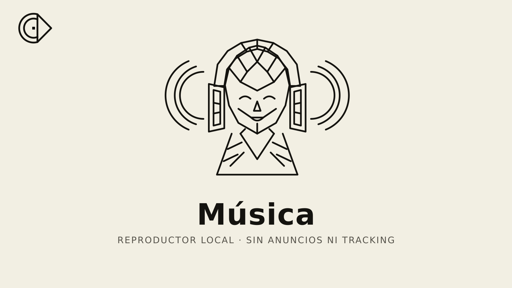
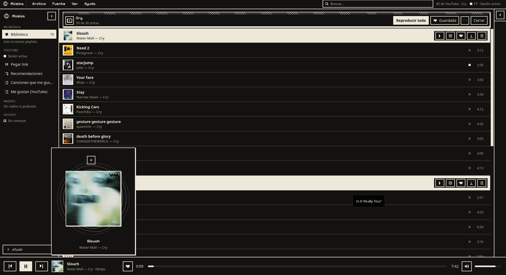
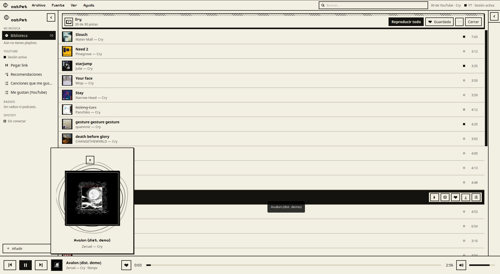
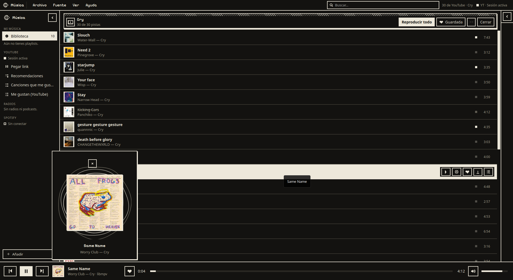
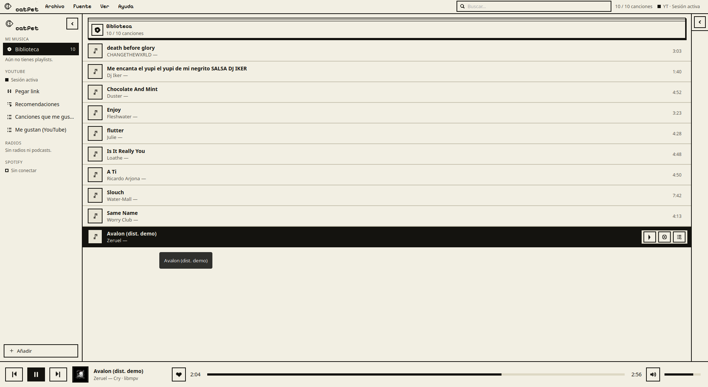
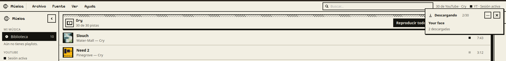

# Música — reproductor de escritorio

<p align="center">
  <picture>
    <source media="(prefers-color-scheme: dark)" srcset="docs/assets/portada-oscura.png" />
    
  </picture>
</p>

Reproductor de escritorio rápido y sin anuncios, con biblioteca local,
búsqueda instantánea, cola, YouTube Music, radios, podcasts, Subsonic/Jellyfin
y Spotify Connect. Interfaz «Mac 1-bit» con tema claro y oscuro.

Hecho con **Tauri 2 + Rust + Svelte 5 + libmpv**. Sin Electron y sin tracking.

## Descargar

<p align="center">
  <a href="https://github.com/YaMeAsesore/catPet/releases/latest">
    
  </a>
  <a href="https://github.com/YaMeAsesore/catPet/releases/latest/download/musica_0.1.0_amd64.deb">
    
  </a>
  <a href="https://github.com/YaMeAsesore/catPet/releases/latest/download/musica-0.1.0-1.x86_64.rpm">
    
  </a>
</p>

| Formato | Enlace | Notas |
| --- | --- | --- |
| **AppImage** (recomendado) | [musica_0.1.0_amd64.AppImage](https://github.com/YaMeAsesore/catPet/releases/latest/download/musica_0.1.0_amd64.AppImage) | Linux x86_64; usar con `Musica.sh` |
| **Debian / Ubuntu** | [musica_0.1.0_amd64.deb](https://github.com/YaMeAsesore/catPet/releases/latest/download/musica_0.1.0_amd64.deb) | `sudo apt install ./musica_0.1.0_amd64.deb` |
| **Fedora / OpenSUSE** | [musica-0.1.0-1.x86_64.rpm](https://github.com/YaMeAsesore/catPet/releases/latest/download/musica-0.1.0-1.x86_64.rpm) | `sudo dnf install ./musica-0.1.0-1.x86_64.rpm` |
| Lanzador AppImage | [Musica.sh](https://github.com/YaMeAsesore/catPet/releases/latest/download/Musica.sh) | Debe ir junto a la AppImage |
| Instrucciones | [LEEME.txt](https://github.com/YaMeAsesore/catPet/releases/latest/download/LEEME.txt) | Requisitos y solución de problemas |
| Hashes | [SHA256SUMS.txt](https://github.com/YaMeAsesore/catPet/releases/latest/download/SHA256SUMS.txt) | Verificación de descargas |

**AppImage (recomendado)**

```bash
chmod +x Musica.sh
./Musica.sh
```

Si la ventana no aparece o se ve negra:

```bash
./Musica.sh soft
```

[Ver todos los releases](https://github.com/YaMeAsesore/catPet/releases)

> **Windows:** todavía no hay binario publicado. El instalador NSIS se puede
> generar con el workflow `Windows` del repositorio.

## Características

- **Biblioteca local**: escaneo incremental, etiquetas con `lofty`, SQLite +
  FTS5 y búsqueda instantánea.
- **Reproducción**: libmpv (gapless, ReplayGain de pista, volumen y seek).
- **Cola**: arrastrar y soltar, reordenar, quitar y persistencia de la sesión.
- **Integración de escritorio**: MPRIS en Linux y SMTC en Windows, teclas
  multimedia y control desde el sistema.
- **YouTube Music**: inicio de sesión, playlists, «Me gusta», recomendaciones,
  importación por lotes y descargas con `yt-dlp`.
- **Otros proveedores**: radios por URL o enlace de emisora de Radio Garden,
  podcasts por RSS, Subsonic/Navidrome y Jellyfin.
- **Spotify Connect** (cuenta Premium): motor nativo con `librespot`.
- **Descargas**: audio original, MP3 o M4A; etiquetas y portada opcionales;
  reanudación y reintentos.
- **Interfaz**: barra lateral, cabeceras por contexto, ajustes, asistente
  «+ Añadir», atajos de teclado y soporte de `prefers-reduced-motion`.
- **Sin anuncios ni telemetría.**

## Capturas

Interfaz «Mac 1-bit», con tema oscuro y claro.

| Reproductor (oscuro) | Reproductor (claro) |
| :---: | :---: |
|  |  |
| **Portada ampliada (oscuro)** | **Biblioteca (claro)** |
|  |  |



## Requisitos

- **Rust** ≥ 1.77 y **Node.js** ≥ 20.
- **Linux**: `libmpv`, `libwebkit2gtk-4.1`, `libgtk-3`, ALSA y un servidor de
  audio (PulseAudio, PipeWire o ALSA).
- **Windows**: WebView2 (incluido en Windows 10/11) y `libmpv-2.dll`.
- Para YouTube y descargas: `yt-dlp` y, recomendable, `ffmpeg`. El proyecto
  incluye scripts que descargan versiones fijas y verificadas.

## Puesta en marcha

```bash
npm ci

# Dependencias incluidas (necesarias para empaquetar y para YouTube/descargas)
./tools/fetch-linux-deps.sh

# Desarrollo con recarga
npx tauri dev
```

En Windows, las dependencias se descargan con:

```powershell
./tools/fetch-windows-deps.ps1
```

También puedes usar `yt-dlp` y `ffmpeg` del sistema si están en el `PATH`.
Los binarios descargados viven en `src-tauri/binaries/` y
`src-tauri/resources/` y **no se versionan** (ver los README de esas carpetas).
El bundle de Linux los declara como recursos, así que hay que descargarlos
antes de `npx tauri build` (y antes de `cargo check`/`cargo build`);
`npm run build` (solo frontend) no los necesita.

## Compilar

```bash
npm run build        # svelte-check + vite
npx tauri build      # binario release + .deb/.rpm/.AppImage
```

Salidas de Linux:

- `src-tauri/target/release/bundle/deb/*.deb`
- `src-tauri/target/release/bundle/rpm/*.rpm`
- `src-tauri/target/release/bundle/appimage/*.AppImage`

El lanzador `./musica.sh` simplifica el desarrollo y la compilación. Ejecútalo
sin `sudo`.

### Wayland / ventana negra

WebKitGTK no crea una ventana fiable en Wayland con esta app. Los lanzadores
fuerzan `GDK_BACKEND=x11` por defecto. Si la ventana sigue sin aparecer o se
queda en negro:

```bash
./musica.sh soft
```

En la AppImage, el lanzador `Musica.sh` acepta el mismo argumento:

```bash
./Musica.sh soft
```

### Windows

`.github/workflows/windows.yml` compila el instalador NSIS en
`windows-latest`, descargando `libmpv`, `ffmpeg` y `yt-dlp` con URL y `sha256`
fijos. Se lanza a mano (`workflow_dispatch`) o con un tag `v*`. El instalador
no está firmado: SmartScreen puede pedir confirmación. **El instalador de
Windows aún no se ha probado en una máquina Windows real**; el checklist está
en [docs/windows.md](docs/windows.md).

## Descargas de YouTube

Las descargas usan la sesión de YouTube conectada en **Ajustes → Sesión de
YouTube**. YouTube exige iniciar sesión en muchos vídeos para confirmar que no
eres un bot; sin sesión, la app lo indica y no se queda esperando un límite
inexistente. Los límites reales de YouTube (`429`) sí se gestionan con una
pausa y reintento automáticos.

Consejos:

- Descarga en lotes pequeños si vas a bajar playlists largas.
- Si cambias de cuenta, cierra sesión, reinicia la app y vuelve a conectar.
- `yt-dlp` cambia a menudo; puedes sustituir el incluido por uno más reciente
  en `~/.local/share/com.musica.app/bin/yt-dlp` (Linux) o
  `%APPDATA%\com.musica.app\bin\yt-dlp.exe` (Windows).

## Radios y podcasts

- **Radio directa**: pega un stream de audio (`.mp3`, `.aac`, `.ogg`, `.m3u8`)
  o una URL `http(s)` que devuelva audio. El nombre es opcional; si lo dejas
  vacío se usa el nombre del host.
- **Radio Garden**: pega el enlace de una emisora
  (`https://radio.garden/listen/<emisora>/<id>`). La app consulta su endpoint
  interno, resuelve la emisora y guarda el stream final. También guarda la
  ciudad y la carátula de la emisora.
- **Streema / LiveOnlineRadio**: pega la página de la emisora; la app extrae
  el stream del reproductor cuando la página lo expone (incluye el caso
  Shoutcast `host:puerto/;`). No todas las webs son compatibles: si no
  encuentra el stream, muestra un aviso y puedes usar el enlace directo.
- **Podcast**: pega el feed RSS.
- Radio Garden no tiene una API oficial; si su endpoint cambia o bloquea la
  petición, usa el enlace directo del stream. La página
  `radio.garden/settings` no es una emisora y se rechaza con un aviso claro.

## Estructura

```text
musica/
├── index.html · package.json · vite.config.ts · svelte.config.js
├── src/
│   ├── main.ts · App.svelte · styles.css
│   ├── assets/
│   │   ├── brand/        # logo, mascotas y portadas (SVG)
│   │   ├── fonts/        # Pixelify Sans (OFL)
│   │   └── icons/        # iconos kawaii y 1-bit
│   └── lib/
│       ├── tauri.ts      # wrappers IPC tipados
│       ├── components/   # Sidebar, PlayerBar, Queue, diálogos…
│       └── ...
├── src-tauri/
│   ├── src/              # backend Rust (biblioteca, player, proveedores…)
│   ├── icons/            # iconos de la app
│   ├── licenses/         # licencias de terceros
│   └── tauri*.conf.json
├── docs/                 # arquitectura y contrato de UI
├── scripts/              # comprobación de contraste WCAG
├── tools/                # descarga verificada de binarios
└── .github/workflows/    # CI de Windows
```

## Documentación

- [Arquitectura de librespot](docs/arquitectura-librespot.md)
- [Contrato de UI](docs/ui-contrato.md)
- [Contextos de la interfaz](docs/ui-contextos.md)
- [Windows: build y pruebas](docs/windows.md)

## Estado

- `svelte-check`: 0 errores, 0 warnings.
- `cargo test --release`: 173 pruebas superadas, 21 ignoradas (red/audio real).
- Linux: probado en Arch/CachyOS y en Ubuntu 22.04 (AppImage en modo
  extract-and-run).
- Windows: el flujo de CI y el instalador existen, pero falta la prueba en
  hardware real.

## Licencia

El código propio de Música se distribuye bajo **MIT** (ver [LICENSE](LICENSE)).
Los binarios y bibliotecas de terceros conservan sus licencias; consulta
[THIRD-PARTY-NOTICES.md](THIRD-PARTY-NOTICES.md) y `src-tauri/licenses/`.

### Aviso legal sobre descargas

La descarga de audio de YouTube y otros sitios **puede ir en contra de sus
Términos de Servicio** y de la legislación aplicable, incluidas medidas
técnicas de protección. Úsala solo con contenido que tengas derecho a
descargar. El proyecto no otorga licencias sobre el contenido descargado. Si
conectas tu cuenta, las descargas usan esa sesión; YouTube puede asociarlas a
tu cuenta.
